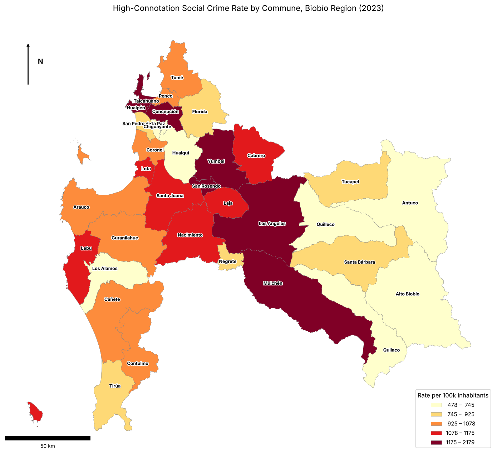
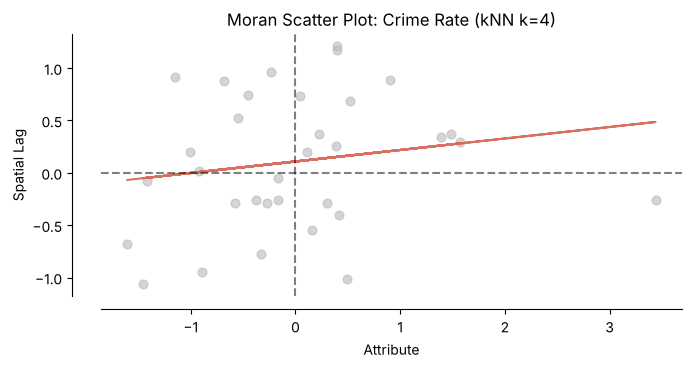
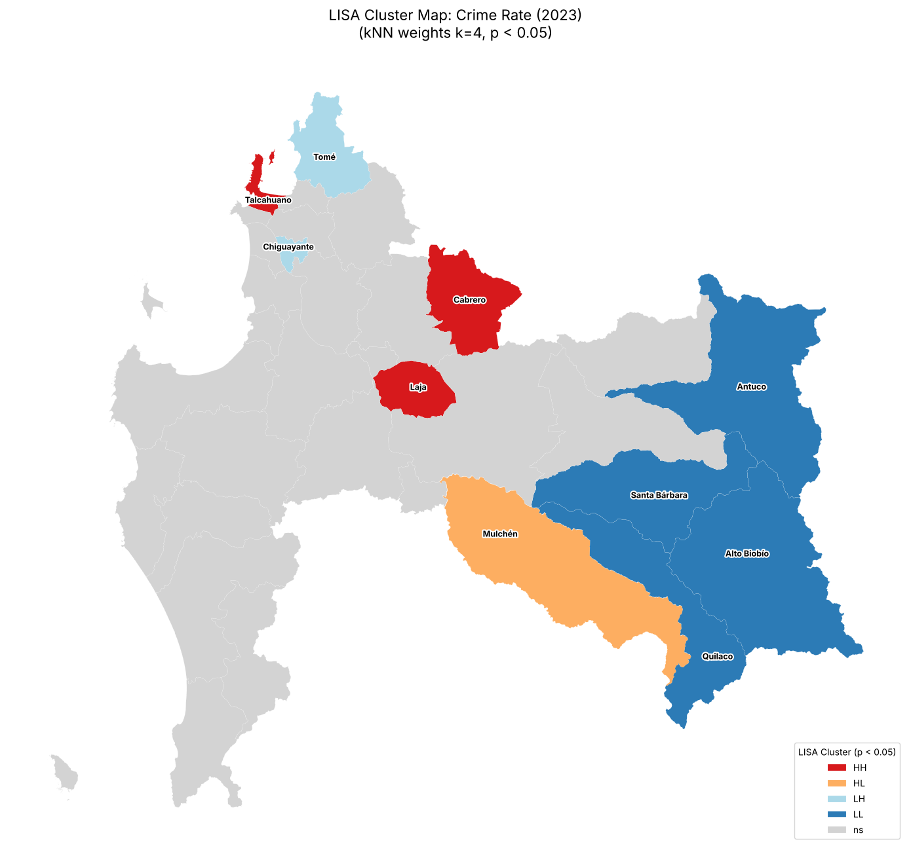

# Spatial Analysis of Crime: Biobío Region (2023)

Applied geostatistical project using techniques from the mining industry, specifically spatial autocorrelation to analyze urban safety. This study identifies statistically significant crime clusters in the Biobío Region of Chile using 2023 social crime data.

## Project Framework
The analysis was built using Python, leveraging **GeoPandas** for spatial data handling and **PySAL (esda)** for statistical testing. The full analysis is in [`biobio_spatial_analysis.ipynb`](biobio_spatial_analysis.ipynb); it downloads the data automatically, so it runs as-is in Google Colab.

---

## 1. Data Visualization: Choropleth Map
Before running statistical tests, I mapped the `F2023` variable, the high-connotation social crime rate per 100,000 inhabitants. This visual inspection shows a clear concentration of high-impact crimes in urban centers compared to rural areas.

## 2. Global Spatial Autocorrelation (Moran's I)
To prove these patterns aren't just random, I calculated the Global Moran's I.

> **Analysis Note:** The result was a positive coefficient of **0.1097** (pseudo $p\text{-value} = 0.069$, 999 permutations, random seed 99 for reproducibility). This suggests a weak positive spatial trend (communes with similar crime levels tend to be neighbors), but it is **not statistically significant at the 5% level**; it is only significant at 10%. For this reason, the local analysis below is used to find where significant clusters do exist.

## 3. Local Clusters (LISA)
While the global test shows the overall trend, LISA identifies exactly where the "Hot Spots" and "Cold Spots" are.

| Cluster Type | Communes | Context |
| :--- | :--- | :--- |
| **HH (High-High)** | **Talcahuano, Laja, Cabrero** | **Hot Spots:** Areas with high crime surrounded by high-crime neighbors. |
| **LL (Low-Low)** | **Alto Biobío, Antuco, Quilaco** | **Cold Spots:** Statistically significant "safe zones." |
| **LH (Low-High)** | **Chiguayante, Tomé** | **Outliers:** Areas with low crime despite being in high-crime zones. |
| **HL (High-Low)** | **Mulchén** | **Outlier:** An isolated peak of high crime in a low-crime area. |

## Strategic Analysis of Crime Clusters

The data suggests an urban-rural divide. The global trend is weak and not significant at 5% ($p = 0.069$), but LISA detects significant local clusters in **Greater Concepción** and the **Los Ángeles** corridor, which deserve a closer look.

### **Operational Insights & Resource Strategy**
From an optimization perspective, these results can serve as a starting point for regional resource allocation. They describe *where* crime concentrates, not *why*, so the points below are hypotheses to validate with further data:

> [!IMPORTANT]
> **1. Targeted Intervention**
> The **High-High clusters** (Talcahuano, Laja, and Cabrero) are the first candidates for prioritizing security efforts and social programs, since they concentrate the highest crime loads in the region.

> [!TIP]
> **2. Staffing Efficiency**
> The **Low-Low coldspots** in the cordillera zone (Alto Biobío, Antuco) have consistently low incidence. Low incidence there may be driven by rurality or under-reporting rather than by current security levels, so any reallocation of personnel toward higher-need urban zones should first be checked against population and reporting data.

> [!NOTE]
> **3. Outlier Investigation**
> The cases of **Mulchén (HL)** and **Tomé (LH)** are geographic anomalies. These require further study to identify specific local variables, such as transit routes or localized economic shifts that cause them to break the broader regional trend.

---
